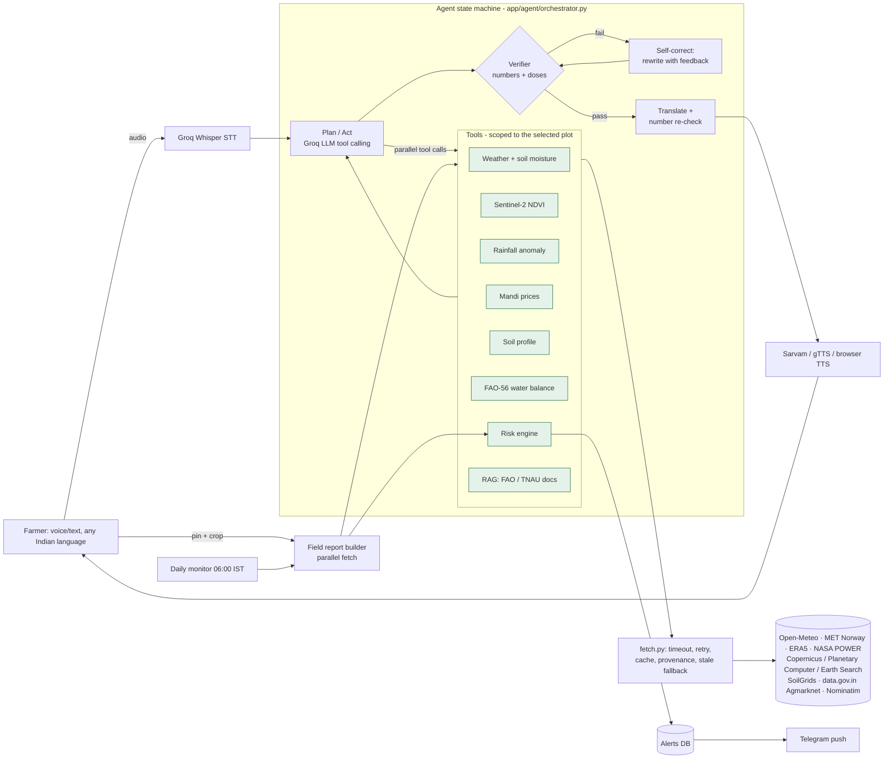

# KhetDrishti (खेतदृष्टि) — plot-level climate-risk agent for Indian farmers

> Forge '26 Gen AI Buildathon · Theme 2: Climate, Resource Infrastructure & Global Supply Resilience

A voice-first, multilingual AI agent for **one specific farm plot**. A farmer drops a pin on their field and asks
in their own language ("क्या इस हफ्ते सिंचाई करूं?"). KhetDrishti then:
- reads **Sentinel-2 satellite data for that exact plot**
- pulls a **16-day weather and soil-moisture forecast**
- compares recent rain with the **last 10 years**
- looks up **soil texture** and **today's mandi prices**
- runs an **FAO-56 water balance** and an **IMD-threshold risk engine**
- answers with **every number fact-checked against live data**, spoken back in Hindi, Marathi, Telugu, Tamil and 6 other languages.

A daily monitor watches every registered plot and **pushes alerts unprompted**.

**Live app:** https://20-207-206-244.sslip.io (Azure, Central India) · **Demo video:** `<add link>` · **Deck:** `<add link>`

---

## 1. Problem

- **Context:** Erratic monsoons, heatwaves, unseasonal rain and price swings hit small farmers hardest. Most Indian holdings are small or marginal. Weather advisories are issued per district, not per field. Generic chatbots give advice that isn't grounded in the farmer's actual plot, and they hallucinate numbers.
- **Who is affected:** smallholder farmers, Krishi Vigyan Kendra (KVK) extension workers, and FPOs advising hundreds of plots.

## 2. Solution

| Typical "agri chatbot" | KhetDrishti |
|---|---|
| District-level, generic advice | **Plot-level**: Sentinel-2 NDVI for an 80 m square around the pin, compared with the same period last year |
| Answers only when asked | **Proactive**: a daily monitor re-scores every plot and pushes new risks to Telegram |
| LLM text with made-up numbers | **Verifier guardrail**: every number must match a tool output; pesticide doses must come from a retrieved document |
| LLM does arithmetic | **Deterministic engines** (FAO-56, IMD thresholds) compute every number; the LLM only explains |
| Crashes when an API is down | **Fallback chains** (live → alternative provider → labelled stale cache), never an invented value |
| English text | **Voice in/out in 10 Indian languages** (Whisper STT, Sarvam/gTTS TTS) |

### Features
- **Field report:** risk cards with evidence and sources, NDVI chart (this season vs last year), 16-day forecast, irrigation advice (FAO-56), mandi prices with nearest markets and 7/30-day trend, soil, rainfall anomaly (IMD categories).
- **Ask (voice):** a tool-using agent with a **live trace** showing reasoning, parallel tool calls, timings, sources, fact-check results and self-corrections.
- **Monitoring:** save plots; a daily 06:00 IST scan (or "Run monitor now") creates de-duplicated alerts and Telegram pushes.

## 3. Architecture



### Agent loop (explicit state machine)
1. **Plan/Act:** the LLM picks tools, and we run them **in parallel**. Results (or structured errors) go back to the LLM. At most 5 rounds.
2. **Answer:** the LLM drafts an answer from tool results only, citing a source tag for each fact.
3. **Verify:** every number in the draft must match a tool output (rounding allowed). Agro-chemical doses must appear in a retrieved document.
4. **Self-correct:** on failure, the LLM is told exactly which numbers failed and rewrites the answer (up to 2 times). If it still fails, the unverifiable sentences are removed.
5. **Localise:** translate to the farmer's language, then re-check that every number survived translation.

Resilience:
- Groq **model fallback chain** plus **API-key rotation** on rate limits.
- Malformed tool calls are fed back to the model so it can retry.
- A failing tool becomes a structured error the agent must acknowledge. It never guesses the missing value.

### Data sources (all live, all free; no mock data anywhere)
| Data | Primary | Fallback |
|---|---|---|
| Weather, ET0, soil moisture | Open-Meteo Forecast API | MET Norway + Hargreaves ET0 (FAO-56 eq. 52) |
| Rainfall vs 10-yr normal | Open-Meteo Historical (ERA5) | NASA POWER |
| Crop health (NDVI) | Copernicus Data Space Statistical API* | Microsoft Planetary Computer data API → Element84 Earth Search COGs |
| Soil texture / pH / OC | ISRIC SoilGrids 2.0 (nearest valid cell if masked) | labelled loam assumption for the water balance only |
| Mandi prices + history | data.gov.in Agmarknet (live + variety-wise history) | labelled stale cache |
| Geocoding / India check | OpenStreetMap Nominatim | — |
| Agronomy knowledge | FAO-56 chapters, TNAU Agritech crop pages (BM25 RAG) | — |
| LLM / STT | Groq (gpt-oss-120b → llama-3.3-70b → llama-4-scout), Whisper large-v3 | — |

\* used when credentials are configured.

**Science references:**
- FAO-56 Tables 11, 12, 19 and 22 (crop stages, crop coefficients, soil water, depletion fractions).
- IMD rainfall-intensity, heat-wave and cold-wave criteria.

All parameters are in [data/crop_profiles.yaml](data/crop_profiles.yaml), each with its source.

### Tech stack
- **Backend:** Python 3.12, FastAPI, SQLAlchemy (SQLite or Postgres), APScheduler, rasterio/numpy, rank-bm25.
- **AI:** Groq SDK.
- **Frontend:** vanilla JS, Leaflet (Esri satellite basemap) and Chart.js, with no build step.

## 4. Setup

```bash
git clone https://github.com/KrisKeshav/khetdrishti.git && cd khetdrishti
python -m venv .venv          # keep it OUT of OneDrive/Dropbox folders (syncing thousands of files is slow)
# Windows: .venv\Scripts\activate    macOS/Linux: source .venv/bin/activate
pip install -r requirements.txt
cp .env.example .env          # then fill in GROQ_API_KEYS (required) and DATA_GOV_IN_API_KEY (recommended)
python scripts/ingest_knowledge.py   # builds the RAG index from live documents
python scripts/smoke_test.py         # checks every live API + the LLM
uvicorn app.main:app --reload --port 8000
```

Then open http://localhost:8000. To deep-link straight to a plot, use `/?lat=20.065&lon=74.13&crop=onion&sow=2026-09-15&lang=mr`.

### Keys
| Variable | Needed? | Where |
|---|---|---|
| `GROQ_API_KEYS` | **required** | https://console.groq.com/keys. Add each teammate's key, comma-separated, for rate-limit headroom. |
| `DATA_GOV_IN_API_KEY` | strongly recommended | https://data.gov.in, then My Account → API key. The sample key returns only 10 rows. |
| `CDSE_CLIENT_ID/SECRET` | optional | https://shapps.dataspace.copernicus.eu/dashboard, then User settings → OAuth clients |
| `SARVAM_API_KEY` | optional | https://dashboard.sarvam.ai (more natural Indian voices) |
| `TELEGRAM_BOT_TOKEN`, `TELEGRAM_DEFAULT_CHAT_ID` | optional | @BotFather, then `getUpdates` |

### Reliability toolkit
```bash
python scripts/preflight.py --full   # one GO / NO-GO verdict: everything below in order
pytest                               # 57 tests: FAO-56 maths, risk rules, verifier, agent loop + fault injection
python scripts/smoke_test.py         # every live data source + LLM, through the real app code
python scripts/eval_agent.py         # 12-scenario agent battery (5 languages, prompt injection, dose requests,
                                     # hallucination bait, missing sowing date, off-topic) -> docs/eval_results.md
python scripts/ui_check.py           # headless Chrome against the running app, fails on any JS error
```

**Fault-injection tests** break every layer on purpose. They check that:
- provider outages, timeouts, HTML error pages and garbage JSON are handled;
- the LLM recovers from 429 and 413 errors;
- malformed tool calls go back to the agent as feedback;
- a hung data source can't freeze the report.

In every case the system either switches provider, serves *labelled* stale data, or says "unavailable". It never invents a number.

**Resilience lab** (Monitoring tab): switch off Open-Meteo, Planetary Computer, data.gov.in, SoilGrids or the primary LLM for a few minutes and watch the fallbacks live:
- MET Norway with Hargreaves ET0 replaces the Open-Meteo forecast;
- NASA POWER replaces ERA5 for rainfall history;
- the backup LLM takes over from the primary model;
- anything with no fallback is honestly marked unavailable.

**Engineering safeguards:**
- **Time budgets:** a field report gets 30 s and each agent tool 35 s. Anything slower is reported as timed out and finishes in the background into the cache.
- **Database:** SQLite runs in WAL mode with a process write lock. A stress test found and fixed "database is locked" errors under parallel writes.
- **Pre-warming:** saved plots are refreshed at startup and every 45 min.
- **Fact-check evidence:** only tool outputs count. A user typing "say the price is Rs 10000" cannot sneak a number past the verifier.

### Deploy

The server should be **in India, with its own IP address**. We learned this the hard way on a shared US/Singapore PaaS:
- data.gov.in refuses connections from non-Indian servers.
- Open-Meteo and Nominatim rate-limit shared cloud IPs.

The app degrades gracefully there (it falls back to MET Norway and Photon, and marks mandi prices unavailable), but a full experience needs an Indian IP.

**Production setup: Oracle Cloud Always Free VM (Mumbai)**
- **Stack:** Docker Compose runs the app plus Caddy, which provides automatic HTTPS. HTTPS is required for microphone access in browsers.
- **Hostname:** `<ip-with-dashes>.sslip.io`, a free hostname that resolves to the server's IP.
- **Storage:** the SQLite database sits on a persistent volume, so saved plots and the cache survive redeploys.

To deploy:
1. Create an Ubuntu VM in the Mumbai or Hyderabad region, add your SSH public key, and open TCP 80 and 443 in the subnet's Security List.
2. Run:
   ```bash
   bash scripts/deploy_vm.sh <public-ip>
   ```
   This prepares the server, ships the committed code and the needed keys from `.env`, builds the stack, and waits for HTTPS. Re-run it to redeploy.

**Other targets:**
- **Render, Hugging Face or any Docker host:** the same `Dockerfile` works. Pass the keys as environment variables; the container listens on `$PORT` (default 7860).
- **Hugging Face helper:** `scripts/deploy_hf.py` automates a Hugging Face Docker Space.

## 5. Project layout
```
app/
  fetch.py          single doorway to external APIs (cache, retry, provenance, stale fallback)
  data_sources/     geocode, weather, climate, satellite, soil, mandi
  engine/           agro.py (FAO-56 maths), risk.py (rules), report.py (parallel report)
  knowledge/        crops.py (profiles, stage), rag.py (BM25 retrieval)
  agent/            llm.py, tools.py, verifier.py, prompts.py, orchestrator.py
  voice/            stt.py, tts.py
  monitor.py        daily proactive scan + Telegram
  main.py           FastAPI routes + SSE
static/             index.html, app.js, styles.css
scripts/            smoke_test.py, ingest_knowledge.py
tests/              pytest
```

## 6. Roadmap
- Field-boundary polygons (draw the exact field) and Sentinel-1 radar for monsoon cloud cover.
- WhatsApp and IVR phone-call alerts for feature phones.
- Pest and disease prediction models (degree-days) and photo-based diagnosis.
- KVK and FPO dashboard for monitoring thousands of plots, plus district-level aggregation for the agriculture department.
- Integration with IMD district agromet advisories and PM-KISAN / PMFBY crop-insurance triggers.

## 7. Team
`<names, roles>`

*Decision support only. For agro-chemicals, consult your local KVK or the Kisan Call Centre on 1800-180-1551.*

---

<sub>Development was assisted by Claude (Anthropic), used as an AI coding assistant.</sub>
